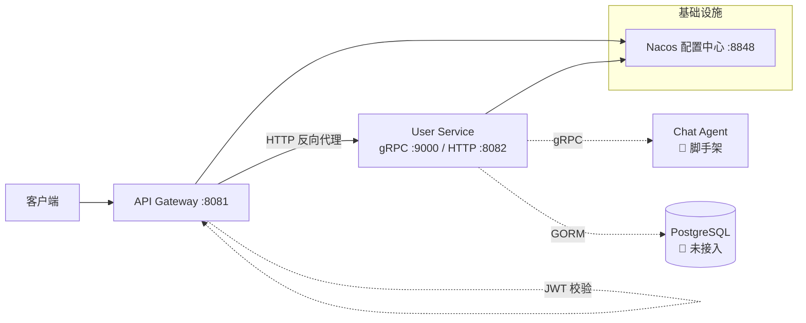

# boys-help-boys

> 一个以微服务架构构建的 Golang 后端项目。  
> 项目名纯属恶搞，请勿过度解读。

## 项目简介

Boys Help Boys 采用 **API Gateway + 业务微服务 + Agent 服务** 的分层设计，模块间通过 gRPC 通信。当前已实现 Gateway 与 User 服务的基础联通（反向代理、登录接口），JWT 鉴权中间件已就绪但尚未接入路由；Agent 服务处于脚手架阶段。

### 架构概览



- **API Gateway**：基于 Gin，负责路由转发、User 服务反向代理、JWT 鉴权（中间件已实现，待接入路由）。
- **User Service**：gRPC 服务 + grpc-gateway HTTP 双协议对外提供登录接口。
- **Chat Agent**：规划中的 AI 能力服务，通过 gRPC 被业务服务调用。

## 技术栈

| 类别 | 技术 | 状态 |
| --- | --- | --- |
| 语言 | Go 1.22+（各模块 go.mod 声明至 1.26） | ✅ |
| Web 框架 | Gin | ✅ |
| RPC | gRPC + Protobuf（buf 代码生成，含 grpc-gateway） | ✅ |
| 认证 | JWT HS256（[golang-jwt/jwt v5](https://github.com/golang-jwt/jwt)） | ✅ |
| 配置 | Nacos 优先，本地 YAML 兜底 | ✅ |
| 日志 | zap（JSON 输出） | ✅ |
| 容器化 | Docker + Docker Compose | ✅ |
| 数据库 | PostgreSQL（容器已就绪） | 🚧 业务未接入 |
| 限流 / 可观测性 | 规划中 | 🚧 |

## 项目结构

```text
boys-help-boys/
├── docker-compose.yaml         # nacos + postgres + gateway
├── common/                     # 公共模块（独立 go.mod）
│   ├── config/                 # Nacos/本地配置读取，返回原始字节流
│   ├── logger/                 # zap 封装
│   ├── nacos/                  # Nacos 客户端
│   ├── jwt/                    # JWT 签发/解析（HS256）
│   └── error/                  # 错误码（占位）
├── gateway/                    # API Gateway（Gin，:8081）
│   ├── cmd/                    # 入口：配置加载 → 路由 → 优雅启停
│   ├── config/                 # 模块配置结构体 + 本地 config.yaml
│   ├── internal/
│   │   ├── middleware/         # JWT 鉴权中间件
│   │   └── router/             # 路由 + User 服务反向代理
│   └── dockerfile
├── user/                       # 用户服务（gRPC :9000 + HTTP :8082）
│   ├── cmd/                    # 入口：gRPC 与 grpc-gateway 双服务
│   ├── config/                 # 模块配置
│   ├── internal/
│   │   ├── rpc_server/         # gRPC 服务实现（Login）
│   │   └── service/            # 业务逻辑（占位）
│   └── Dockerfile
├── agents/
│   └── chat/                   # 对话 Agent（🚧 仅 go.mod / Dockerfile / configs）
├── proto/                      # Protobuf 契约与生成代码（独立 go.mod，buf 管理）
│   ├── user/v1/                # user.proto、login.proto
│   ├── common/v1/              # resp.proto（通用响应结构）
│   ├── user/gen/               # 生成的 gRPC / grpc-gateway 代码
│   └── common/gen/
└── README.md
```

### 模块依赖方式

各模块拥有**独立 go.mod**，通过 `replace` 指令引用本地模块（早期的 `go.work` 方案已移除）：

```go
// gateway/go.mod、user/go.mod
replace github.com/bluenotbloo/boys-help-boys/common => ../common
```

## 配置加载

加载优先级：**Nacos → 本地 YAML 兜底**。

1. `common/config` 读取 Nacos 配置（环境变量 `NACOS_ADDR` / `NACOS_PORT` / `NACOS_NAMESPACE` / `NACOS_DATA_ID` / `NACOS_GROUP`），失败则回退本地文件（`LOCAL_CONFIG_FILE`，默认 `config.yaml`）。
2. `common` 只返回**原始 `[]byte`**，不做反序列化；各模块用 `gopkg.in/yaml.v3` 反序列化到自己的配置结构体。
3. 每个模块目录下有独立 `.env`（已 gitignore，需自建），通过 `NACOS_DATA_ID` / `NACOS_GROUP` 区分不同模块的配置，如 `user` 服务使用 `DATA_ID=1`、`GROUP=user`。

## 端口一览

| 服务 | 协议 | 地址 | 说明 |
| --- | --- | --- | --- |
| Gateway | HTTP | `127.0.0.1:8081` | 对外入口，反代 User HTTP |
| User | HTTP | `127.0.0.1:8082` | grpc-gateway |
| User | gRPC | `127.0.0.1:9000` | gRPC + reflection |
| Chat Agent | — | `8083 / 9100` | 🚧 未实现 |
| Nacos | HTTP | `127.0.0.1:8848` | 配置中心 |
| PostgreSQL | TCP | `127.0.0.1:5432` | 仅绑定本机回环 |

## 快速开始

### 前置条件

- Go 1.22+
- Docker & Docker Compose
- [buf](https://buf.build)（可选，重新生成 proto 代码时使用）

### 1. 克隆仓库

```bash
git clone https://github.com/bluenotbloo/boys-help-boys.git
cd boys-help-boys
```

### 2. 启动基础设施

```bash
docker compose up -d
```

包含：Nacos、PostgreSQL（仅 `127.0.0.1:5432` 可访问）、Gateway 镜像。

### 3. 准备 .env

`.env` 不入库，需在模块目录下自行创建（可参考各模块 `.env` 注释）：

```bash
# gateway/.env 与 user/.env 通用模板
NACOS_ADDR=127.0.0.1
NACOS_PORT=8848
NACOS_NAMESPACE=<你的命名空间ID>
NACOS_DATA_ID=1        # gateway 用 2，user 用 1
NACOS_GROUP=user       # gateway 用 gateway
LOCAL_CONFIG_FILE=./config/config.yaml
```

### 4. 本地启动服务（开发模式）

```bash
# 启动 User Service（gRPC :9000 + HTTP :8082）
cd user
go run ./cmd

# 启动 Gateway（HTTP :8081）
cd gateway
go run ./cmd
```

> 本地工作区若配置了 `.vscode/launch.json`（已 gitignore，不入库），也可直接使用 VS Code Run & Debug 启动 `gateway` / `user`。

### 5. 验证

```bash
# Gateway 占位路由
curl http://127.0.0.1:8081/hello

# 登录（经 Gateway 反代 → user grpc-gateway）
curl -X POST http://127.0.0.1:8081/api/v1/user/login \
  -H "Content-Type: application/json" \
  -d '{"username":"admin","password":"123456"}'
```

当前登录为占位实现：非空用户名/密码即返回 `user_id`。也可用 grpcurl 直连 gRPC 调试（已注册 reflection）：

```bash
grpcurl -plaintext -d '{"username":"admin","password":"123456"}' \
  127.0.0.1:9000 user.v1.UserService/Login
```

## API

| 方法 | 路径 | 说明 |
| --- | --- | --- |
| GET | `/hello` | Gateway 占位路由 |
| POST | `/api/v1/user/login` | 登录（Gateway 反代 → user grpc-gateway） |

HTTP 契约由 proto 注解生成，见 `proto/user/v1/user.proto`：

```proto
rpc Login(LoginRequest) returns (LoginResponse) {
  option (google.api.http) = { post: "/api/v1/user/login"; body: "*" };
}
```

## Protobuf 代码生成

proto 模块使用 buf 管理，需在 `buf.yaml` 所在的 `proto/` 目录下执行，生成配置位于 `proto/user/buf.gen.yaml` 与 `proto/common/buf.gen.yaml`，生成代码输出到对应 `gen/` 目录：

```bash
cd proto
buf generate --template user/buf.gen.yaml
buf generate --template common/buf.gen.yaml --path common/v1
```

## 路线图

- [ ] Gateway 路由接入 JWT 鉴权中间件，登录接口签发 token
- [ ] User 服务接入 PostgreSQL（GORM）与密码哈希
- [ ] Chat Agent 服务实现，业务服务通过 gRPC 调用
- [ ] Gateway 上游接入 Nacos 服务发现（替代静态 upstream 配置）
- [ ] Redis、限流、链路追踪（Jaeger）等可观测性能力
- [ ] 修复 `user/Dockerfile`、`agents/chat/Dockerfile`（仍引用已删除的 `go.work`）
- [ ] User / Chat Agent 接入 docker-compose

## 贡献指南

1. Fork 本仓库
2. 创建特性分支（`git checkout -b feature/amazing-feature`）
3. 提交更改（`git commit -m 'Add some amazing feature'`）
4. 推送到分支（`git push origin feature/amazing-feature`）
5. 创建 Pull Request

## License

[MIT](./LICENSE) © Song Yuxuan
